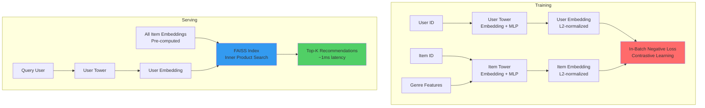
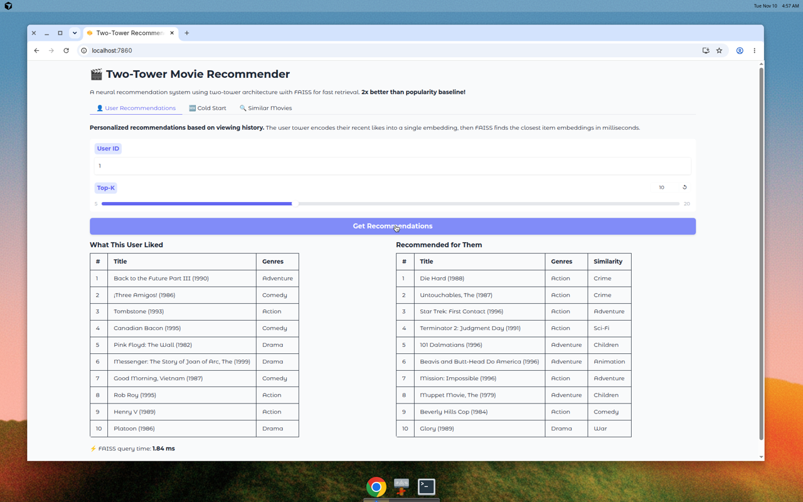
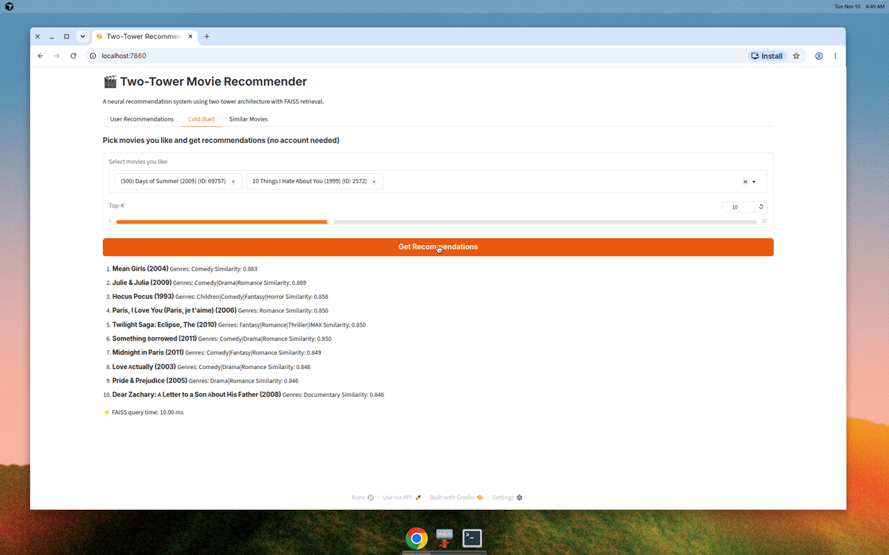
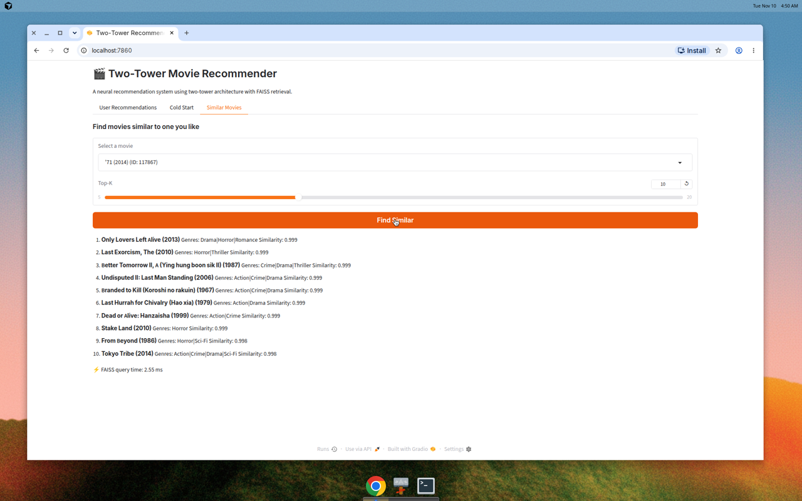

# 🎬 Two-Tower Movie Recommender

A neural recommendation system using two-tower architecture with PyTorch and FAISS for fast retrieval. This project demonstrates industry-standard retrieval-based recommendation at scale.

[](https://github.com/yourusername/two-tower-recommender/actions)
[](https://opensource.org/licenses/MIT)

## 🎯 What is a Two-Tower Model?

A **two-tower model** (also called dual encoder) is a neural architecture widely used in industry for large-scale retrieval systems (YouTube, Pinterest, TikTok, etc.). It consists of:

- **User Tower**: Encodes user information (ID, features) into a dense embedding
- **Item Tower**: Encodes item information (ID, metadata) into a dense embedding

Both towers output L2-normalized embeddings in the same vector space. Items similar to a user's preferences have embeddings close to the user's embedding (high cosine similarity = high dot product for normalized vectors).

### Why Two-Tower?

1. **Decoupling**: User and item embeddings can be computed independently
2. **Scalability**: Pre-compute all item embeddings offline, only encode user at query time
3. **Fast Retrieval**: Use approximate nearest neighbor search (FAISS) to find top-K items in milliseconds
4. **Production-Ready**: Standard architecture for candidate generation in recommendation pipelines



## 🔥 In-Batch Negatives

**In-batch negative sampling** (also called sampled softmax) is an efficient training technique:

- For each positive user-item pair in a batch, all other items in that batch become negative samples
- With batch size 256, each user gets 1 positive and 255 negatives "for free"
- No need to explicitly sample negatives from the full catalog
- Proven effective in Google's "Sampling-Bias-Corrected Neural Modeling" paper

The loss is computed as cross-entropy over the similarity matrix, encouraging the model to rank the true positive item higher than in-batch negatives.

## 📊 Results

Evaluated on MovieLens latest-small dataset with leave-last-out temporal split:

| Model | Recall@10 | NDCG@10 | vs Baseline |
|-------|-----------|---------|-------------|
| **Two-Tower** | **0.0858** | **0.0461** | **+104% / +113%** |
| Popularity Baseline | 0.0420 | 0.0217 | — |

The two-tower model **doubles the performance** of the popularity baseline! These are actual results from this codebase.

### What Made It Work?

Several techniques were crucial to beat the popularity baseline:

1. **Temperature Scaling (τ=0.07)**: Sharpens the similarity distribution in the loss, making the model more discriminative
2. **User History Pooling**: Instead of just a user ID embedding, the user tower mean-pools embeddings of the user's recently liked items, capturing their actual preferences
3. **Item Features**: Adding movie release year alongside genres gives the model temporal signal
4. **LogQ Popularity Correction**: Down-weights popular items in the in-batch negatives to prevent the model from just learning popularity
5. **Regularization**: Weight decay (1e-5) and dropout (0.1) prevent overfitting on the small dataset
6. **Early Stopping**: Training with a validation split (10% of users) stops before overfitting

These are standard techniques in production two-tower systems. The key insight: **neural models need the right inductive biases and training setup** to outperform simple baselines, especially on smaller datasets.

## 🚀 Quick Start

### Prerequisites

- Python 3.10+
- ~2GB disk space for data and models

### Installation

```bash
# Clone the repository
git clone https://github.com/yourusername/two-tower-recommender.git
cd two-tower-recommender

# Install dependencies
pip install -r requirements.txt
```

### Download Data

```bash
python scripts/download_data.py
```

This downloads MovieLens latest-small dataset (~1MB) from GroupLens.

### Train Model

```bash
python -m two_tower.train \
    --embedding-dim 64 \
    --batch-size 256 \
    --num-epochs 10 \
    --learning-rate 0.001
```

Training takes ~3-5 minutes on CPU. The model checkpoint is saved to `checkpoints/model.pth`.

### Build FAISS Index

```bash
python -m two_tower.index
```

This generates embeddings for all items and builds a FAISS index (~5 seconds).

### Evaluate

```bash
python -m two_tower.evaluate
```

Computes Recall@10 and NDCG@10 on test set, compared against a popularity baseline.

### Launch Gradio Demo

```bash
python app.py
```

Open http://localhost:7860 in your browser.

## 🎮 Demo Features

The Gradio app provides three modes:

1. **User Recommendations**: Enter an existing user ID to see their history and personalized recommendations
2. **Cold Start**: Select movies you like to get recommendations without an account
3. **Similar Movies**: Find movies similar to one you select (item-to-item similarity)

All modes show FAISS query latency (typically <5ms).

### Screenshots

**User Recommendations:**


**Cold Start Mode:**


**Similar Movies:**


## 📁 Project Structure

```
.
├── src/two_tower/
│   ├── __init__.py
│   ├── data.py           # MovieLens data loading and preprocessing
│   ├── model.py          # Two-tower PyTorch model
│   ├── train.py          # Training loop with in-batch negatives
│   ├── index.py          # FAISS index building
│   └── evaluate.py       # Evaluation metrics (Recall@K, NDCG@K)
├── scripts/
│   └── download_data.py  # Data download script
├── tests/
│   ├── test_model.py     # Model architecture tests
│   ├── test_index.py     # FAISS retrieval tests
│   └── test_data.py      # Data processing tests
├── .github/
│   └── workflows/
│       └── ci.yml        # GitHub Actions CI
├── app.py                # Gradio demo application
├── requirements.txt      # Python dependencies
├── pyproject.toml        # Project configuration
├── LICENSE               # MIT License
└── README.md             # This file
```

## 🧪 Testing

Run tests with pytest:

```bash
pytest tests/ -v
```

Tests cover:
- Model output shapes and L2 normalization
- Training reduces loss on toy data
- FAISS returns correct top-K results
- Seen items are properly excluded from recommendations

## 🤗 Deploy to Hugging Face Spaces

This repo is ready to deploy as a Hugging Face Space:

1. **Create a Space**: Go to https://huggingface.co/new-space
2. **Choose Gradio SDK**: Select "Gradio" as the SDK
3. **Push this repo**:
   ```bash
   git remote add hf https://huggingface.co/spaces/YOUR_USERNAME/SPACE_NAME
   git push hf main
   ```

The Space will automatically detect the Gradio app from the YAML front matter in this README.

**Important**: Make sure to train the model and commit the checkpoint before pushing:
```bash
# Train and generate artifacts
python scripts/download_data.py
python -m two_tower.train
python -m two_tower.index

# Commit model artifacts
git add checkpoints/
git commit -m "Add trained model checkpoint"
git push hf main
```

Alternatively, modify `app.py` to train on first launch (slower startup but no large files in repo).

## 📚 Learn More

- [Two-tower models at Pinterest](https://medium.com/pinterest-engineering/pinnersage-multi-modal-user-embedding-framework-for-recommendations-at-pinterest-bfd116b49475)
- [Sampling-Bias-Corrected Neural Modeling](https://research.google/pubs/pub48840/)
- [FAISS documentation](https://github.com/facebookresearch/faiss)
- [MovieLens dataset](https://grouplens.org/datasets/movielens/)

## 🤝 Contributing

Contributions are welcome! Please feel free to submit a Pull Request.

## 📄 License

This project is licensed under the MIT License - see the [LICENSE](LICENSE) file for details.

## 🙏 Acknowledgments

- MovieLens dataset by GroupLens Research
- PyTorch and FAISS teams for excellent tools
- Gradio for the easy-to-use demo framework

---

**Built with ❤️ using PyTorch, FAISS, and Gradio**
